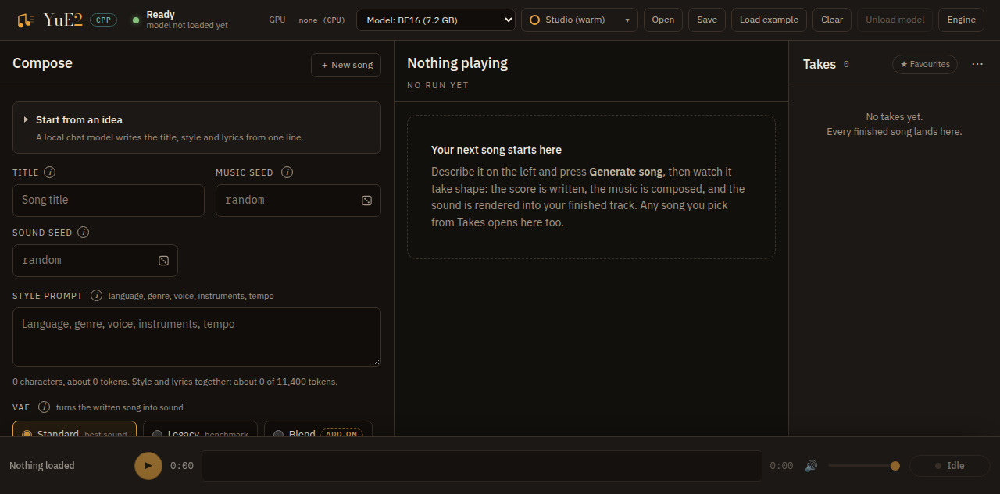
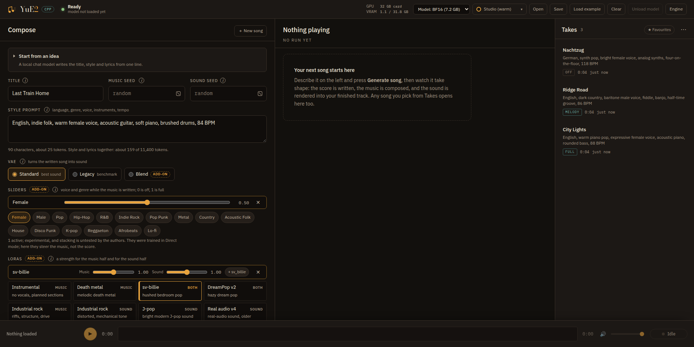
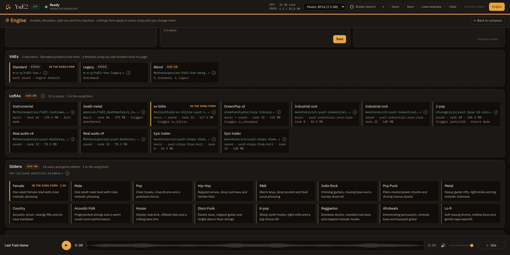
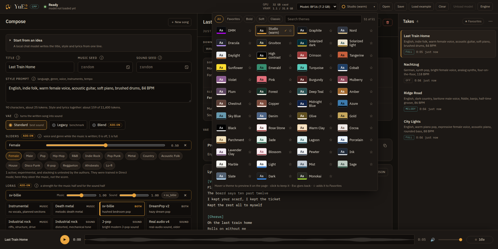
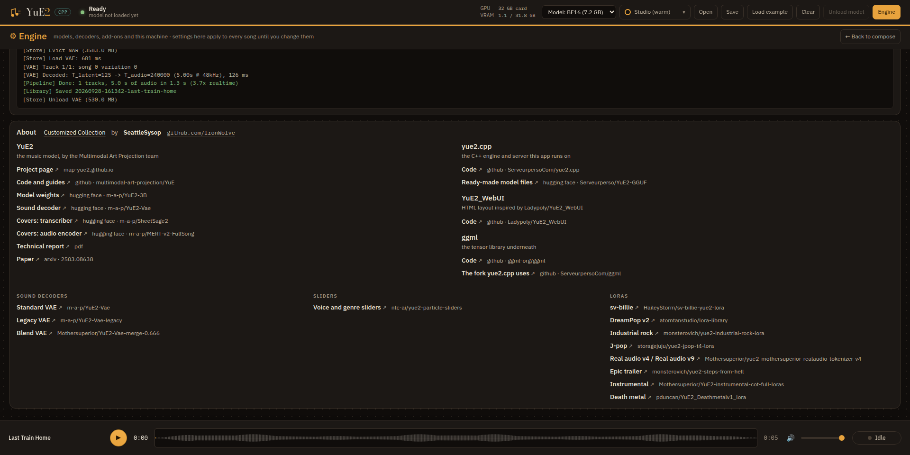

<h1 align="center">yue2-kit</h1>

<p align="center"><b>(Yue2 Installer)</b></p>

<p align="center">Original kit code: <a href="LICENSE">Apache License 2.0</a> · <a href="NOTICE">Attribution</a></p>

<p align="center">
  YuE2 install kit with new features, LoRAs, VAEs and more.<br>
  Whole songs with vocals, from a style prompt and lyrics, on your own GPU.
</p>

<p align="center">
  
  
  
  
  
  
</p>

<p align="center">
  
</p>

> **AI agent:** to install or upgrade, follow [INSTALL.md](INSTALL.md).

## What it is

[YuE2](https://map-yue2.github.io/) writes whole songs, vocals included. This kit sets it up on
[yue2.cpp](https://github.com/ServeurpersoCom/yue2.cpp), a fast C++ engine, and adds a full studio page,
90 LoRAs, 5 VAEs and 16 voice and genre sliders on top. You can run the installer yourself or have an AI coding agent follow the guide. The kit builds in a separate folder.

<table>
  <tr>
    <td width="50%"><br><sub><b>Compose</b>: style, lyrics, VAE, sliders and LoRAs</sub></td>
    <td width="50%"><br><sub><b>Engine</b>: every VAE, LoRA and slider, with its source</sub></td>
  </tr>
  <tr>
    <td width="50%"><br><sub><b>51 themes</b>, Studio by default</sub></td>
    <td width="50%"><br><sub><b>About</b>: every project and add-on, linked</sub></td>
  </tr>
</table>

_The gallery shows v12. v13 keeps this layout and updates the engine and controls._

## Features

- **A studio page**: song form, song page and library side by side, with columns you can drag wider or
  narrower, 51 colour themes with an Appearance card (fonts, corners, hover colour, glow), and an (i) help
  on every setting.
- **Add-ons**: 5 VAEs (Standard, Legacy, Blend and both RS x3 variants), 16 stackable voice and genre sliders,
  and 90 LoRAs, each with its own strength for the music and the sound, and trigger guidance where available.
- **Songs**: Full plan, Melody only and Direct modes, the official Instrumental mode, covers from a
  recording (listen to it first) or from a song, and an editable score. Retake, Reuse, or give a song
  another VAE. Continue a saved take or use the optional tools to continue an uploaded recording.
- **Library**: every song kept on disk, with favourites and versions; FLAC, WAV and MP3 downloads named
  after the song (or with the date, if you prefer);
  double-click a song to play it. Play a completed take while the rest of its batch renders.
- **Idea writer**: a local chat model drafts the title, style and lyrics from one line; a Connected or
  Offline button shows the chat server's state at a glance.
- **Engine page**: memory presets from 8 to 32 GB, a hardware readout, the live server log, the Appearance card,
  and an About card with every link.
- **Engine patches**: score repair and retries, independent acoustic chunk sizing, smaller decoder tiles when memory is tight, and a fix for the CUDA padding crash during sound generation.

## Install

1. Extract the [v13 installer ZIP](https://github.com/IronWolve/yue2-kit/releases/tag/v13) or clone this repo.
2. Follow [INSTALL.md](INSTALL.md) to build the server and download the model groups you want. You can also
   ask an AI coding agent to follow those steps.
3. From the install folder, run `./start.sh` and open <http://127.0.0.1:41867>.

**You need** Linux or WSL2, Git, curl, Bash, a C++17 compiler, CMake 3.24+, Ninja and Python 3.11+.
The GPU build needs an NVIDIA driver and CUDA toolkit compatible with your GPU. The guide also covers
a CPU build. Allow space for the selected model downloads, engine sources and build.

## What's inside

```
INSTALL.md     install and upgrade steps
engines/cpp/   engine and GGML patches, pinned revisions and the embedded Studio
page/          the web page as plain files
app/           installer, launcher and pinned download manifest
loras/         the LoRA, VAE and slider names, descriptions and links
docs/          screenshots
```

What changed in each version: [CHANGELOG.md](CHANGELOG.md).

## What it downloads

Every file is pinned by revision and checksum in the [asset manifest](app/assets.json).
The stock BF16 setup with Standard VAE needs **7.70 GB** of downloads. The compact setup with
Standard VAE needs **3.15 GB**. All groups together need **45.71 GB**.

### The model

| | What it does | From | Size | Group |
|---|---|---|---:|---|
| **YuE2 3B BF16** | Stock song model and default backbone. | [Serveurperso/YuE2-GGUF](https://huggingface.co/Serveurperso/YuE2-GGUF) <sub>`e630f2b`</sub> | 7.17 GB | `core` |
| **YuE2 3B Q5_K_M** | Smaller stock song model. | [Serveurperso/YuE2-GGUF](https://huggingface.co/Serveurperso/YuE2-GGUF) <sub>`e630f2b`</sub> | 2.62 GB | `compact` |
| **SheetSage2** | The transcriber for covers from a recording. | [Serveurperso/YuE2-GGUF](https://huggingface.co/Serveurperso/YuE2-GGUF) <sub>`e630f2b`</sub> | 229 MB | `recordings` |
| **MERT v2** | The audio encoder the transcriber listens with. | [Serveurperso/YuE2-GGUF](https://huggingface.co/Serveurperso/YuE2-GGUF) <sub>`e630f2b`</sub> | 2.53 GB | `recordings` |
| **Audio tokenizer** | Supplies music tokens for recording continuation. | [Serveurperso/YuE2-GGUF](https://huggingface.co/Serveurperso/YuE2-GGUF) <sub>`e630f2b`</sub> | 171 MB | `recordings` |
| **Tsunami Wave 2.0 × 0.75** | Optional BF16 fine-tune. | [goldhub/YuE2-RS-Finetunes](https://huggingface.co/goldhub/YuE2-RS-Finetunes) <sub>`8ba3e2c`</sub> | 7.17 GB | `ruach` |
| **Tsunami Wave 2.0 × 0.9** | Optional stronger BF16 fine-tune. | [goldhub/YuE2-RS-Finetunes](https://huggingface.co/goldhub/YuE2-RS-Finetunes) <sub>`8ba3e2c`</sub> | 7.17 GB | `ruach` |

### Sound decoders (VAEs)

| | | What it is | From | Size |
|---|---|---|---|---:|
| **Standard** | stock | The official default decoder. | [Serveurperso/YuE2-GGUF](https://huggingface.co/Serveurperso/YuE2-GGUF) <sub>`e630f2b`</sub> | 530 MB |
| **Legacy** | stock | The older official decoder. | [m-a-p/YuE2-Vae-legacy](https://huggingface.co/m-a-p/YuE2-Vae-legacy) <sub>`d0585a9`</sub> | 531 MB |
| **Blend** | add-on | 2/3 Standard + 1/3 Legacy. Converted during setup. | [Mothersuperior/YuE2-Vae-merge-0.666](https://huggingface.co/Mothersuperior/YuE2-Vae-merge-0.666) <sub>`b00bdfc`</sub> | 531 MB |
| **RS x3 v1** | add-on | Expanded float32 decoder. | [goldhub/YuE2-RS-Finetunes](https://huggingface.co/goldhub/YuE2-RS-Finetunes) <sub>`8ba3e2c`</sub> | 803 MB |
| **RS x3 v2** | add-on | Second expanded float32 decoder. | [goldhub/YuE2-RS-Finetunes](https://huggingface.co/goldhub/YuE2-RS-Finetunes) <sub>`8ba3e2c`</sub> | 803 MB |

### Voice and genre sliders

| | | Which | From | Size |
|---|---|---|---|---:|
| **16 sliders** | add-on | Female, Male, Pop, Hip-Hop, R&B, Indie Rock, Pop Punk, Metal, Country, Acoustic Folk, House, Disco Funk, K-pop, Reggaeton, Afrobeats, Lo-fi. | [ntc-ai/yue2-particle-sliders](https://huggingface.co/ntc-ai/yue2-particle-sliders) <sub>`3164931`</sub> | 257 MB |

### LoRAs (90)

The optional LoRA group contains 90 adapters and their settings (15.20 GB). The [catalog](loras/sources.json)
lists the full set with source links and usage notes. Here are the original eleven styles and adapters
from the earlier kit.

| LoRA | Sound | Steers | From | Size |
|---|---|---|---|---:|
| **sv-billie** | hushed bedroom pop | music + sound | [HaileyStorm/sv-billie-yue2-lora](https://huggingface.co/HaileyStorm/sv-billie-yue2-lora) <sub>`94fe9fb`</sub> | 118 MB |
| **DreamPop v2** | hazy dream pop | music + sound | [atomtanstudio/lora-library](https://huggingface.co/atomtanstudio/lora-library/tree/main/yue2/dreampop) <sub>`af2250e`</sub> | 235 MB |
| **Industrial rock** | riffs, structure, drive | music | [monsterovich/yue2-industrial-rock-lora](https://huggingface.co/monsterovich/yue2-industrial-rock-lora) <sub>`a71706d`</sub> | 35 MB |
| **Industrial rock** | distorted, mechanical tone | sound | [monsterovich/yue2-industrial-rock-lora](https://huggingface.co/monsterovich/yue2-industrial-rock-lora) <sub>`a71706d`</sub> | 140 MB |
| **J-pop** | bright modern J-pop sound | sound | [storagejuju/yue2-jpop-t4-lora](https://huggingface.co/storagejuju/yue2-jpop-t4-lora) <sub>`16c181c`</sub> | 106 MB |
| **Real audio v4** | real-audio sound, older | sound | [Mothersuperior/yue2-mothersuperior-realaudio-tokenizer-v4](https://huggingface.co/Mothersuperior/yue2-mothersuperior-realaudio-tokenizer-v4) <sub>`e2e63d8`</sub> | 70 MB |
| **Real audio v9** | real-audio sound, newest | sound | [Mothersuperior/yue2-mothersuperior-realaudio-tokenizer-v4](https://huggingface.co/Mothersuperior/yue2-mothersuperior-realaudio-tokenizer-v4) <sub>`e2e63d8`</sub> | 70 MB |
| **Epic trailer** | orchestral structure, drama | music | [monsterovich/yue2-steps-from-hell](https://huggingface.co/monsterovich/yue2-steps-from-hell) <sub>`87c2469`</sub> | 35 MB |
| **Epic trailer** | big orchestra and choir tone | sound | [monsterovich/yue2-steps-from-hell](https://huggingface.co/monsterovich/yue2-steps-from-hell) <sub>`87c2469`</sub> | 140 MB |
| **Instrumental** | no vocals, planned sections | music | [Mothersuperior/YuE2-instrumental-cot-full-loras](https://huggingface.co/Mothersuperior/YuE2-instrumental-cot-full-loras) <sub>`947f2f4`</sub> | 140 MB |
| **Death metal** | melodic death metal | music | [pduncan/YuE2_Deathmetalv1_lora](https://huggingface.co/pduncan/YuE2_Deathmetalv1_lora) <sub>`24853e7`</sub> | 279 MB |

### Code

| | What it is | From |
|---|---|---|
| **yue2.cpp** | The C++ engine with the kit's local patches | [ServeurpersoCom/yue2.cpp](https://github.com/ServeurpersoCom/yue2.cpp) <sub>`e646d52`</sub> |
| **ggml** | Its tensor library (the engine's own fork) | [ServeurpersoCom/ggml](https://github.com/ServeurpersoCom/ggml) <sub>`ef4555b7`</sub> |
| **Python packages** | For the model converter, at pinned versions | [app/converter-requirements.txt](app/converter-requirements.txt) |

## Links

| Project | Links |
|---|---|
| **YuE2**, the music model, by the Multimodal Art Projection team | [Project page](https://map-yue2.github.io/) · [Code and guides](https://github.com/multimodal-art-projection/YuE) · [Model weights](https://huggingface.co/m-a-p/YuE2-3B) · [Sound decoder](https://huggingface.co/m-a-p/YuE2-Vae) · [Technical report](https://github.com/multimodal-art-projection/YuE/blob/main/docs/technical_report.pdf) · [Paper](https://arxiv.org/abs/2503.08638) |
| **yue2.cpp**, the C++ engine and server | [Code](https://github.com/ServeurpersoCom/yue2.cpp) · [Ready-made model files](https://huggingface.co/Serveurperso/YuE2-GGUF) |
| **ggml**, the tensor library underneath | [Code](https://github.com/ggml-org/ggml) · [The fork yue2.cpp uses](https://github.com/ServeurpersoCom/ggml) |
| **This kit** | [SeattleSysop on GitHub](https://github.com/IronWolve) |

## Credits and licences

Customized Collection by **SeattleSysop** ([github.com/IronWolve](https://github.com/IronWolve)).

The original yue2-kit contributions by SeattleSysop (IronWolve), including the
kit scripts, documentation, studio page customizations and engine modifications,
are licensed under the [Apache License 2.0](LICENSE). See [NOTICE](NOTICE) for
attribution. Distributed derivatives must preserve applicable attribution as
required by section 4 of the license; a credit in your README or About page is
appreciated, but is not an additional license condition.

Third-party code, assets, model weights and adapters retain their existing
licenses and notices. Apache 2.0 applies to the original kit contributions, not
to those third-party materials.

HTML layout inspired by [Ladypoly/YuE2_WebUI](https://github.com/Ladypoly/YuE2_WebUI).

- **YuE2 weights**: CC BY-NC 4.0, with a creator permission for selling your own songs (the
  `MODEL_LICENSE` in [multimodal-art-projection/YuE](https://github.com/multimodal-art-projection/YuE)).
- **Code**: yue2.cpp and the sliders are MIT.
- **LoRAs**: community add-ons; each one's page (linked above) has its terms.
